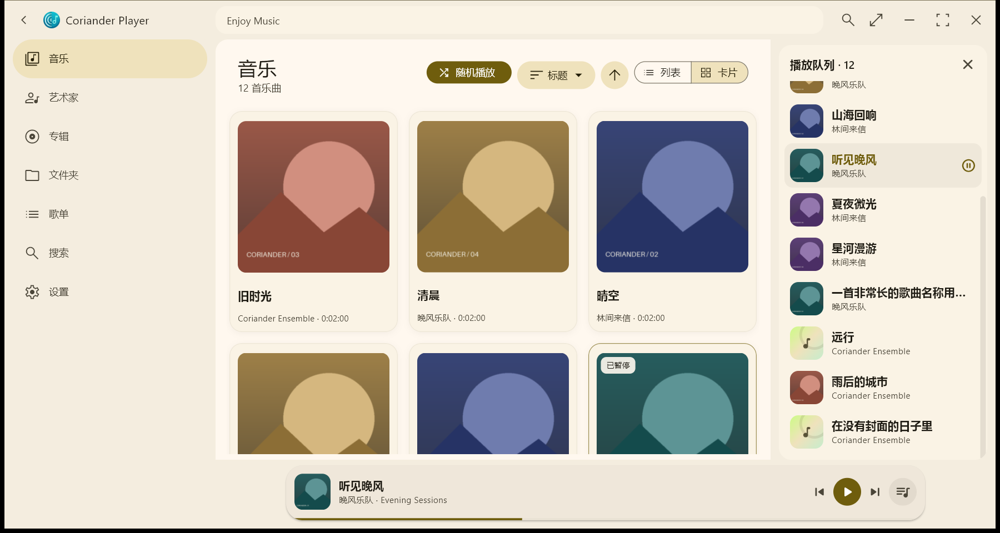

# Coriander Player 增强版

基于 Material Design 3 的 Windows 本地音乐播放器。

**源项目：[@Ferry-200/coriander_player](https://github.com/Ferry-200/coriander_player)，原作者：@Ferry-200。**

本仓库是由 @2465911331 维护的非官方增强分支，保留原项目的版权与 GPL-3.0 许可证。感谢原作者及所有上游贡献者；本分支的新增功能与问题请在本仓库讨论。

## 下载与安装

- **[下载 1.5.7 EXE 安装包](https://github.com/2465911331/coriander_player/releases/download/v1.5.7/CorianderPlayer-Setup-1.5.7.exe)**
- [查看全部发行版本](https://github.com/2465911331/coriander_player/releases)
- Windows 10/11，64 位。
- 支持覆盖安装，无需先卸载；沿用原安装目录并保留音乐库、歌单、设置及播放记录。安装器会先请求目标目录中的旧播放器正常退出。

安装包 SHA256：

```text
9c7bd9b2a2f727984c4beb6e5036e015ada47a29d95bef1ab143d87cb0288e82
```



## 1.5.7 更新

- 独立底部播放区，不遮挡内容；加入上一首、下一首和队列入口。
- 统一 Material Design 3 的主题表面、文字层级、圆角、播放/暂停与键盘焦点提示。
- 列表/卡片分段切换、排序选中提示；歌曲行高适应文字放大。
- 搜索歌曲、艺术家、专辑的即时建议及完整分类结果；支持 Ctrl+F。
- 设置分为播放与窗口、声音、音乐库、外观与动效、关于五组。
- 删除歌单后 6 秒内可撤销，原音乐文件不会被删除。
- 底部封面与播放页共享过渡；宽屏播放队列侧栏和窄窗口弹出队列。
- 修复 Esc 重复返回与播放快捷键重复注册。

详见 [更新说明](CHANGELOG.md) 与 [界面实现说明](docs/material-design-3-implementation.md)。

## 本分支已加入的功能

- 关闭行为设置：隐藏到托盘、直接退出或每次询问；托盘显示主界面与退出。
- 恢复上次歌曲、队列、播放进度和随机状态，启动后保持暂停。
- 文件夹刷新、无缝播放、歌曲音量统一及智能歌单。
- 波浪进度条、整曲波形、黑胶唱片、频谱、封面背景及歌词美化。
- 音乐库卡片、封面占位、悬停快捷播放与减少动画设置。

## 快捷键

| 操作 | 快捷键 |
| --- | --- |
| 搜索/聚焦搜索 | Ctrl + F |
| 播放/暂停 | 空格 |
| 上一首 / 下一首 | Ctrl + 左 / 右方向键 |
| 关闭面板或返回 | Esc |

输入文字时暂停全局播放快捷键，避免误操作。

## 开发与验证

源代码与该版本安装包一起公开。[编译说明](docs/build-windows.md) 包含 Flutter、Rust、原生库与安装器准备方式；[打包说明](packaging/README.md) 保留本版使用的稳定安装标识和覆盖升级逻辑。

本版 107 项自动测试通过；静态检查无错误、无警告。已在隔离目录实测 1.5.6 → 1.5.7 覆盖升级及数据保留。

当前安装版的“检查更新”仍查询上游发行信息。本分支的新版本请以[本仓库 Releases](https://github.com/2465911331/coriander_player/releases)为准；问题反馈请使用[本仓库 Issues](https://github.com/2465911331/coriander_player/issues)。

## 致谢与许可

- 原项目与作者：[@Ferry-200/coriander_player](https://github.com/Ferry-200/coriander_player) / @Ferry-200。
- 桌面歌词组件：[Ferry-200/desktop_lyric](https://github.com/Ferry-200/desktop_lyric)。
- 音乐匹配与歌词：[yhsj0919/music_api](https://github.com/yhsj0919/music_api)。
- 保留上游使用的 BASS、Lofty、flutter_rust_bridge 及图标作者 Silicon7921 等贡献者的署名。
- 本项目沿用 [GPL-3.0](LICENSE)，第三方组件保留各自的许可证和声明。
- [上游原版 README](docs/upstream-readme.md) 保留原项目的格式支持、歌词特性和历史说明。
